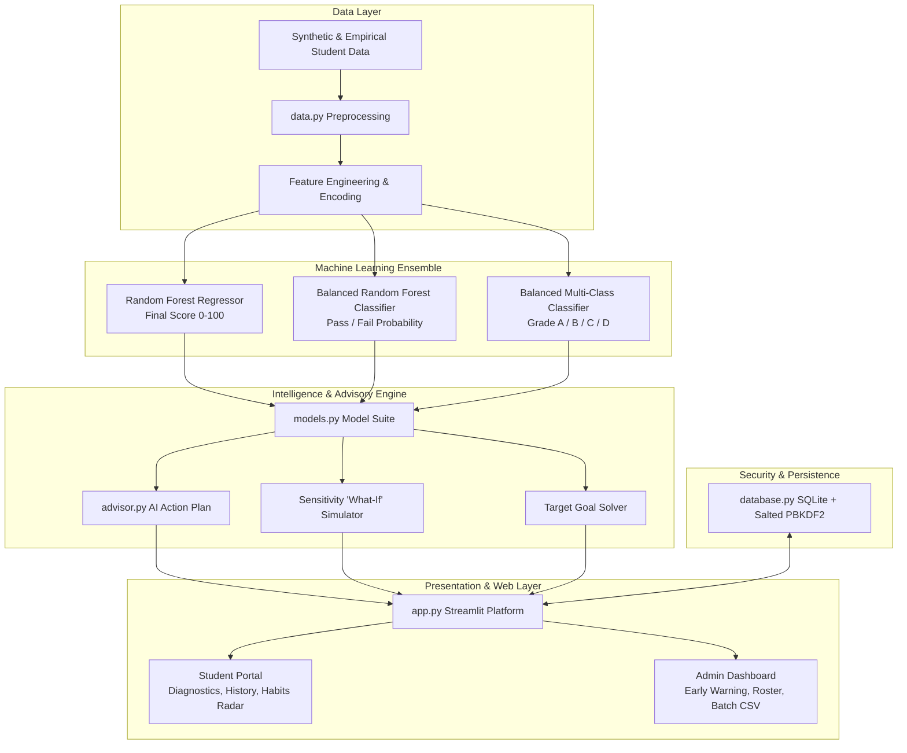

# 🎓 EduPredict AI — Student Performance Predictor & Advisory Platform

[](https://python.org)
[](https://streamlit.io)
[](https://scikit-learn.org)
[](https://plotly.com)
[](LICENSE)
[]()

> **An enterprise-grade, multi-target Machine Learning analytics platform and academic early-warning system.**  
> EduPredict AI forecasts student exam scores, pass/fail trajectories, and letter grades (A–D), while providing actionable AI coaching plans, interactive what-if sensitivity simulations, and institutional cohort risk monitoring.

---

## 📑 Table of Contents

- [Overview](#-overview)
- [System Architecture](#-system-architecture)
- [Key Features](#-key-features)
  - [Student Experience](#1-student-experience)
  - [Faculty & Institutional Administration](#2-faculty--institutional-administration)
- [Machine Learning Pipeline & Benchmarks](#-machine-learning-pipeline--benchmarks)
- [Project Directory Structure](#-project-directory-structure)
- [Installation & Quickstart](#-installation--quickstart)
- [Default Demo Credentials](#-default-demo-credentials)
- [Running Unit & Integration Tests](#-running-unit--integration-tests)
- [License & Acknowledgments](#-license--acknowledgments)

---

## 🌟 Overview

Academic performance is shaped by an interconnected web of study discipline, attendance consistency, prior baseline proficiency, and lifestyle balance. **EduPredict AI** bridges predictive data science and actionable educational pedagogy by answering three critical questions:

1. **Where does the student stand right now?** (Numeric score, pass/fail probability, letter grade)
2. **What factors are holding them back?** (Identified performance barriers such as sleep deficits, low attendance, or insufficient study volume)
3. **What specific, quantifiable actions will improve their grade?** (Dynamic what-if sensitivity simulation and target goal solving)

---

## 🏛️ System Architecture



---

## 🚀 Key Features

### 1. Student Experience
- **Multi-Target Prediction**: Simultaneously forecasts continuous exam score (0–100), letter grade (A, B, C, D), and binary pass/fail probability.
- **Interactive Radial Gauge & Class Confidence**: Dynamic Plotly gauges render performance bands with confidence bars across letter grades.
- **Interactive "What-If" Sensitivity Simulator**: Real-time sliders allow students to test study adjustments (e.g., *"+4 hrs/week study + 90% attendance"*) and watch projected score gains update live.
- **AI Academic Action Plan**: Algorithmic advisory engine produces prioritized, actionable recommendations tailored to individual habits (e.g., Pomodoro study routines, sleep hygiene targets, lecture attendance thresholds).
- **Habit Benchmark Radar Chart**: Compares personal weekly study, attendance, and rest habits against top-quintile (A-Grade) student benchmarks.
- **Target Goal Planner**: Inverse solver calculates the exact hours and attendance required to reach a target grade.
- **Printable Performance Diagnostic**: One-click download of official diagnostic reports (`.txt` / Markdown).

### 2. Faculty & Institutional Administration
- **Executive KPI Dashboard**: Instant visibility into total enrollments, cohort average score, passing percentage, and at-risk student counts.
- **Academic Early-Warning System**: Automatically flags students falling below passing thresholds (score < 50 or failing) for timely tutoring intervention.
- **Interactive Cohort Visualizations**: Donut charts for letter grade distribution, histograms with kernel density estimates (KDE), and feature importance bar charts.
- **Batch CSV Ingestion**: Upload an entire class roster in CSV format to compute batch predictions, view instant summary metrics, and download enriched result files.
- **Student Roster Management**: Searchable and filterable student database with drill-down views into individual historical prediction trajectories.

### 3. Enterprise Security
- **Salted PBKDF2 Password Hashing**: Passwords stored using 100,000 rounds of PBKDF2-HMAC-SHA256 with cryptographically random per-user salts.
- **Transparent Legacy Hash Migration**: Automatically upgrades legacy plain SHA-256 hashes upon login without user friction.
- **Role-Based Access Control (RBAC)**: Enforced separation between student and administrative privilege levels.

---

## 📊 Machine Learning Pipeline & Benchmarks

The predictive engine is trained on validated academic behavioral profiles across primary features:
- `study_hours_per_week` (Continuous, 0–40)
- `attendance_percent` (Continuous, 30–100%)
- `previous_score` (Continuous, 0–100)
- `sleep_hours` (Continuous, 3–10)
- `parental_education` (Categorical: high school, bachelors, masters, phd)
- `internet_access` (Categorical: yes, no)
- `extracurricular` (Categorical: yes, no)

### Model Benchmark Evaluation

| Target Metric | Model Architecture | Metric | Test Score |
| :--- | :--- | :--- | :--- |
| **Final Exam Score** | Random Forest Regressor (200 trees) | **MAE** | **~4.9 points** |
| | | **RMSE** | **~6.1 points** |
| | | **R² Score** | **~0.85** |
| | | **5-Fold CV R²** | **~0.84** |
| **Pass / Fail** | Balanced Random Forest Classifier | **Accuracy** | **~99.0%** |
| | | **Weighted F1** | **~0.99** |
| **Letter Grade (A/B/C/D)** | Balanced Multi-Class Classifier | **Accuracy** | **~78.5%** |
| | | **Weighted F1** | **~0.78** |

---

## 📁 Project Directory Structure

```text
student-performance-predictor/
├── src/                               # Core Python Package
│   └── student_predictor/
│       ├── __init__.py                # Package declaration & version metadata
│       ├── data.py                    # Dataset generator, validation & splits
│       ├── models.py                  # Model suite, training & inference engine
│       ├── advisor.py                 # Action plan generator & what-if simulator
│       └── database.py                # Salted PBKDF2 auth & SQLite layer
├── tests/                             # Automated Test Suite
│   ├── test_database.py               # Unit tests for persistence & auth
│   └── test_models.py                 # Unit tests for models & advisory engine
├── 1_generate_dataset.py              # CLI Dataset generator
├── 2_train_models.py                  # CLI ML training pipeline & evaluation
├── 3_predict_new_student.py           # CLI Real-time student inference demo
├── app.py                             # Flagship Streamlit Web Application
├── website.py                         # Secondary runner wrapper for app.py
├── database.py                        # Legacy bridge to src.student_predictor.database
├── requirements.txt                   # Production dependencies
├── .gitignore                         # Version control ignore rules
└── README.md                          # Platform documentation
```

---

## 💻 Installation & Quickstart

### 1. Clone & Set Up Environment

```bash
# Clone the repository
git clone https://github.com/megha468/student-performance-predictor.git
cd student-performance-predictor

# Optional: Create and activate virtual environment
python -m venv venv
# Windows:
.\venv\Scripts\activate
# Linux/macOS:
source venv/bin/activate
```

### 2. Install Dependencies

```bash
pip install -r requirements.txt
```

### 3. Launch the Web Application

You can launch the web application with either:

```bash
streamlit run app.py
```
*or*
```bash
streamlit run website.py
```

Open your browser at `http://localhost:8501`.

---

## 🔑 Default Demo Credentials

| Role | Username | Password | Privileges |
| :--- | :--- | :--- | :--- |
| **System Administrator** | `admin` | `admin123` | Institutional KPIs, Early Warning Alerts, Student Management, Batch CSV Ingestion |
| **Student** | *Register in UI* | *Chosen in UI* | Personal Diagnostics, What-If Simulator, History & Radar, Goal Planner |

> **Note**: An instant interactive sandbox is also accessible directly on the landing page without requiring authentication!

---

## 🧪 Running Unit & Integration Tests

The project includes unit and integration tests covering database integrity, salted authentication, model inference, and recommendation logic.

Run the test suite via `unittest`:

```bash
python -m unittest discover tests
```

Expected output:
```text
..........
----------------------------------------------------------------------
Ran 10 tests in ~20s

OK
```

---

## 🛠️ CLI Pipeline Utilities

In addition to the interactive web application, standalone command-line scripts are available for automated workflows:

```bash
# 1. Regenerate 1,000 synthetic student behavioral records:
python 1_generate_dataset.py

# 2. Re-train all machine learning models & generate evaluation plots:
python 2_train_models.py

# 3. Run instant CLI inference and academic advisory on sample student profiles:
python 3_predict_new_student.py
```

---

## 📄 License & Acknowledgments

This project is licensed under the **MIT License**. Created by [Megha Argade](https://github.com/megha468).
Contributions and academic extensions are welcome!
